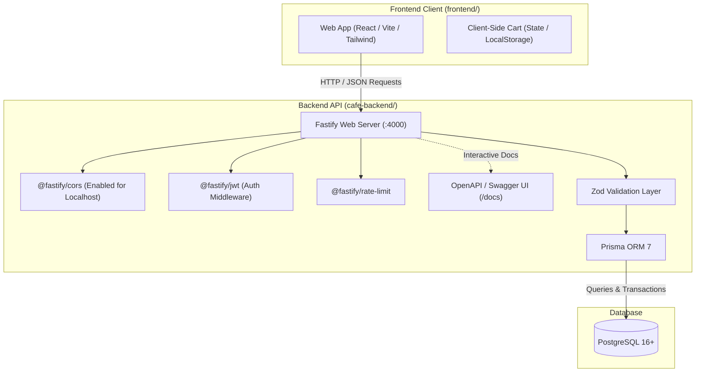

# ☕ Cafe Website (cafe-v1)

A modern full-stack Cafe web application featuring online menu browsing, customer authentication, demonstration order checkout, and table reservations.

This repository is structured as a modular monorepo containing both the backend REST API (`cafe-backend/`) and the client web application (`frontend/`).

---

## 📑 Table of Contents
- [Project Overview](#-project-overview)
- [System Architecture](#-system-architecture)
- [Repository Structure](#-repository-structure)
- [Frontend Developer's Integration Guide](#-frontend-developers-integration-guide)
  - [API Conventions & Response Envelopes](#1-api-conventions--response-envelopes)
  - [Authentication & JWT](#2-authentication--jwt)
  - [Cart & Order Processing](#3-cart--order-processing-crucial)
  - [Table Reservations & Timezones](#4-table-reservations--timezones)
- [Complete API Endpoint Reference](#-complete-api-endpoint-reference)
- [Local Setup & Getting Started](#-local-setup--getting-started)
  - [Running the Backend with Docker (Recommended)](#a-running-with-docker-compose-recommended)
  - [Running the Backend Manually (Node.js + PostgreSQL)](#b-running-manually)
  - [Frontend Development](#c-frontend-development)
- [Branching & Collaboration Strategy](#-branching--collaboration-strategy)

---

## 🌟 Project Overview

The Cafe platform provides a seamless digital experience for cafe customers and managers:
1. **Public Menu Browsing:** Customers can view menu items organized by categories (Coffee, Tea, Cold Beverages, Snacks, Desserts) with live availability flags and item details.
2. **Customer Authentication:** Secure customer registration and login with 7-day JWT tokens and password hashing via bcrypt.
3. **Interactive Cart & Checkout:** Client-side cart persistence with server-verified demonstration order creation.
4. **Order History & Graceful Cancellation:** Order snapshot history with a 60-second immediate cancellation window.
5. **Table Reservations:** Future table bookings for 1–6 guests with India Standard Time (`Asia/Kolkata`) scheduling and a 24-hour advance cancellation rule.
6. **Admin Management:** Protected administrative endpoints to create, update, and manage categories and menu offerings.

---

## 🏛️ System Architecture

The project follows a **Modular Monolith** architecture designed for reliability, fast response times, and clear domain separation.



### Backend Internal Architecture (`cafe-backend/src/modules/`)
Each domain is isolated into its own cohesive module containing routes, controllers, validation schemas, and service logic:
* **`auth/`**: Registration, login, password comparison via bcrypt, and JWT token issuance.
* **`users/`**: Customer profile retrieval (`/users/me`).
* **`categories/`**: Category queries and admin category lifecycle (preventing deletion if menu items exist).
* **`menu/`**: Filterable available menu listings for visitors, and full catalog control for admins.
* **`orders/`**: Total price calculation, price snapshotting, demo order notice, and cancellation boundary validation.
* **`reservations/`**: Local time validation (`Asia/Kolkata`), future date validation, guest count limits, and 24-hour cancellation rule.
* **`plugins/`**: Global error handling (Zod, Prisma, Fastify error normalization), auth guards, and sensitive log redaction.

---

## 📁 Repository Structure

```text
cafe-v1/
├── cafe-backend/              # Fastify TypeScript modular monolith backend
│   ├── prisma/                # Database schema, seed files & SQL migrations
│   │   ├── migrations/        # Version-controlled database migrations
│   │   ├── schema.prisma      # Prisma ORM schema (User, Category, MenuItem, Order, etc.)
│   │   └── seed.ts            # Idempotent seed script (categories + admin identity)
│   ├── src/
│   │   ├── lib/               # Utility functions (errors, time, money arithmetic)
│   │   ├── modules/           # Domain modules (auth, users, categories, menu, orders, reservations)
│   │   ├── plugins/           # Fastify plugins (auth, error-handler)
│   │   ├── app.ts             # Fastify application setup, CORS, Swagger, & route registration
│   │   ├── config.ts          # Environment configuration & validation
│   │   └── server.ts          # Server entry point (listens on PORT 4000)
│   ├── tests/                 # Unit, domain, and API integration test suite (Vitest)
│   ├── docker-compose.yml     # Standalone Docker Compose for PostgreSQL + API
│   ├── Dockerfile             # Production container definition
│   ├── .env.example           # Backend environment variables template
│   └── package.json           # Backend scripts and dependencies
│
├── frontend/                  # Frontend application workspace (React / Vite)
│   └── README.md              # Frontend specific setup and notes
│
├── .gitignore                 # Root gitignore (ignores node_modules, .env, *.zip)
└── README.md                  # Project overview, architecture & developer guide (this file)
```

---

## 🔌 Frontend Developer's Integration Guide

If you are developing the frontend, here are the essential rules and patterns to know:

### 1. API Conventions & Response Envelopes
* **Base URL:** `http://localhost:4000/api/v1`
* **Swagger UI Documentation:** `http://localhost:4000/docs` (Interactive API tester with schema details).
* **CORS:** Enabled on the backend. Requests from `http://localhost:5173`, `http://localhost:3000`, etc., are accepted.

#### Standard Success Envelope
All successful responses return HTTP `200` or `201` with this structure:
```json
{
  "success": true,
  "message": "Menu retrieved successfully",
  "data": {
    "items": [ ... ]
  }
}
```
*(Notice: arrays are usually wrapped in named properties like `data.items` or `data.categories`).*

#### Standard Error Envelope
Failed responses return an HTTP `4xx` or `500` with this structure:
```json
{
  "success": false,
  "message": "Validation failed",
  "errors": [
    {
      "field": "email",
      "message": "Invalid email address"
    }
  ]
}
```

---

### 2. Authentication & JWT
* **Protected Routes:** Send the token in the HTTP `Authorization` header:
  ```http
  Authorization: Bearer <your_jwt_token>
  ```
* **Stateless Tokens:** Tokens are valid for 7 days.
* **Logout Flow:** Logout is **stateless**. The frontend logs out the customer simply by deleting the saved JWT from storage/cookies. The `POST /api/v1/auth/logout` endpoint exists to formally acknowledge the logout action.

---

### 3. Cart & Order Processing (Crucial!)
* **No Server-Side Cart:** There is deliberately **no cart table or cart endpoint** on the backend. The cart is completely managed by the frontend (in React state or `localStorage`).
* **Price Tampering Protection:** When a user checks out, the frontend **only sends item IDs and quantities**. The backend recalculates totals using current database prices.
  ```json
  // POST /api/v1/orders
  {
    "items": [
      { "menuItemId": "c0a80123-4567-89ab-cdef-0123456789ab", "quantity": 2 }
    ]
  }
  ```
* **Order Item Constraints:** Quantity per item must be between `1` and `10`.
* **Demonstration Notice:** Orders are demo orders. The server returns a note stating no real payment was processed.
* **60-Second Cancellation Limit:** Customers can cancel an order (`POST /api/v1/orders/:id/cancel`) **only within 60 seconds** of its creation. After 60 seconds, cancellation is rejected with `400 Bad Request`.

---

### 4. Table Reservations & Timezones
* **Timezone Standard:** Input date-times must be formatted as `YYYY-MM-DDTHH:mm` (e.g., `2027-01-15T19:30`) and are strictly interpreted as **Asia/Kolkata (UTC+05:30)**.
* **Reservation Constraints:**
  - `guestCount` must be between `1` and `6`.
  - Date must be in the future.
* **24-Hour Cancellation Limit:** A customer can cancel a reservation (`POST /api/v1/reservations/:id/cancel`) **only if at least 24 hours remain** before the booked time.

---

## 📋 Complete API Endpoint Reference

All endpoints are prefixed with `/api/v1`:

| Method | Endpoint | Access Level | Description |
|---|---|---|---|
| `POST` | `/auth/register` | Public | Register a new customer account |
| `POST` | `/auth/login` | Public | Login with email & password (returns 7-day JWT) |
| `POST` | `/auth/logout` | Authenticated | Acknowledges stateless token discard |
| `GET` | `/users/me` | Authenticated | Retrieve current user's profile |
| `GET` | `/categories` | Public | List all active menu categories |
| `GET` | `/menu` | Public | Browse available menu items (supports `?categoryId=UUID`) |
| `GET` | `/menu/:id` | Public | Get details of a single available menu item |
| `POST` | `/orders` | Customer | Place a demonstration order |
| `GET` | `/orders` | Customer | Retrieve customer's order history |
| `GET` | `/orders/:id` | Customer | Retrieve specific order details |
| `POST` | `/orders/:id/cancel` | Customer | Cancel order (allowed within 60s of placement) |
| `POST` | `/reservations` | Customer | Book a table reservation |
| `GET` | `/reservations` | Customer | Retrieve reservations (filter: `upcoming`, `previous`, `cancelled`) |
| `POST` | `/reservations/:id/cancel` | Customer | Cancel reservation (allowed until 24 hours prior) |
| `POST` | `/admin/categories` | Admin Only | Create a new menu category |
| `PATCH` | `/admin/categories/:id` | Admin Only | Rename an existing category |
| `DELETE` | `/admin/categories/:id` | Admin Only | Delete an empty category |
| `GET` | `/admin/menu-items` | Admin Only | List all menu items (including unavailable items) |
| `POST` | `/admin/menu-items` | Admin Only | Create a new menu item |
| `PATCH` | `/admin/menu-items/:id` | Admin Only | Update item details, price, or availability |
| `DELETE` | `/admin/menu-items/:id` | Admin Only | Permanently delete a menu item |
| `GET` | `/health` | Public | API and PostgreSQL database health check |

---

## 🚀 Local Setup & Getting Started

### A. Running with Docker Compose (Recommended)
Docker will start PostgreSQL and the Fastify backend automatically with migrations and seeds applied:

```bash
cd cafe-backend

# 1. Create your local environment file
cp .env.example .env

# 2. Build and start containers
docker compose up --build
```
* Backend API will be live at: `http://localhost:4000`
* Swagger docs available at: `http://localhost:4000/docs`

---

### B. Running Manually
If you prefer running Node.js and PostgreSQL locally:

```bash
cd cafe-backend

# 1. Install dependencies
npm install

# 2. Copy environment file and configure DATABASE_URL
cp .env.example .env

# 3. Generate Prisma client, run migrations, and seed default data
npm run db:generate
npm run db:deploy
npm run db:seed

# 4. Start development server with hot-reload
npm run dev
```

---

### C. Frontend Development
To start developing the frontend:
```bash
cd frontend

# Initialize or run your frontend setup (e.g., Vite + React)
npm install
npm run dev
```
Point your frontend API calls to `http://localhost:4000/api/v1`.

---

## 🌿 Branching & Collaboration Strategy

To work simultaneously without stepping on each other's code:
1. `main` branch holds the stable, verified backend and production code.
2. Frontend developers can work on dedicated branches:
   * `frontend-hardik`
   * `frontend-<friend-name>`
3. Once a feature or complete frontend version is ready, open a **Pull Request (PR)** into `main`.
